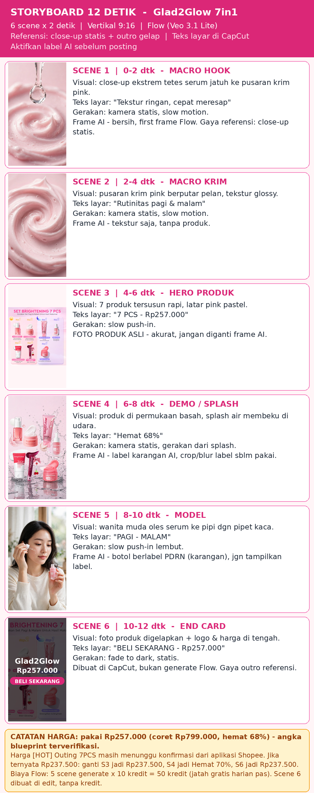
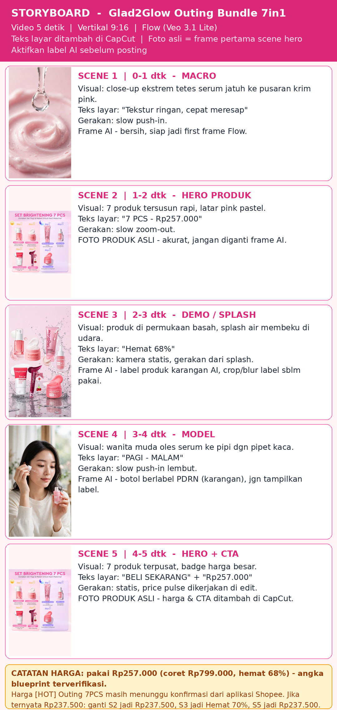
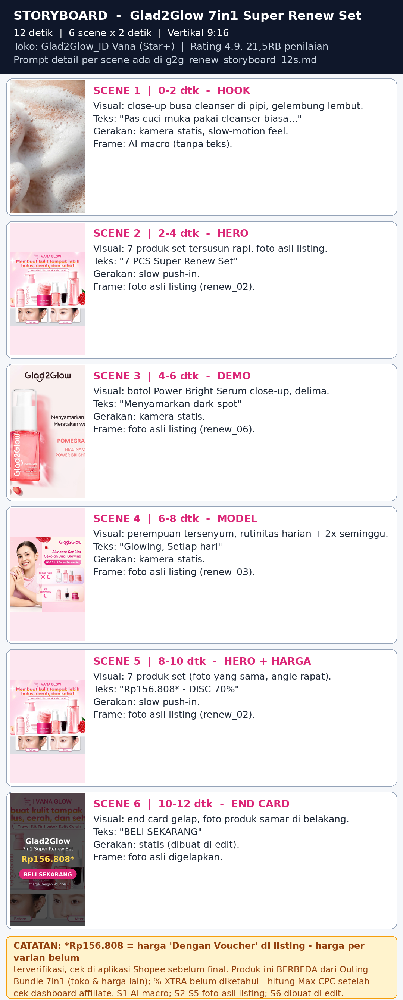
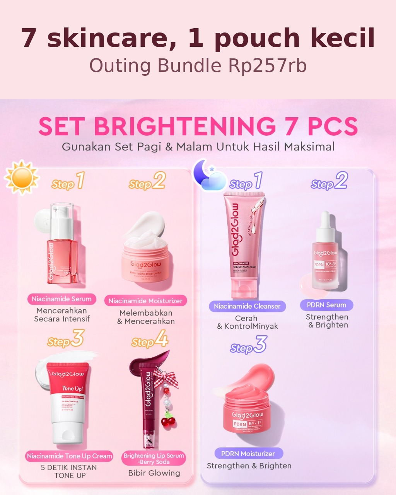
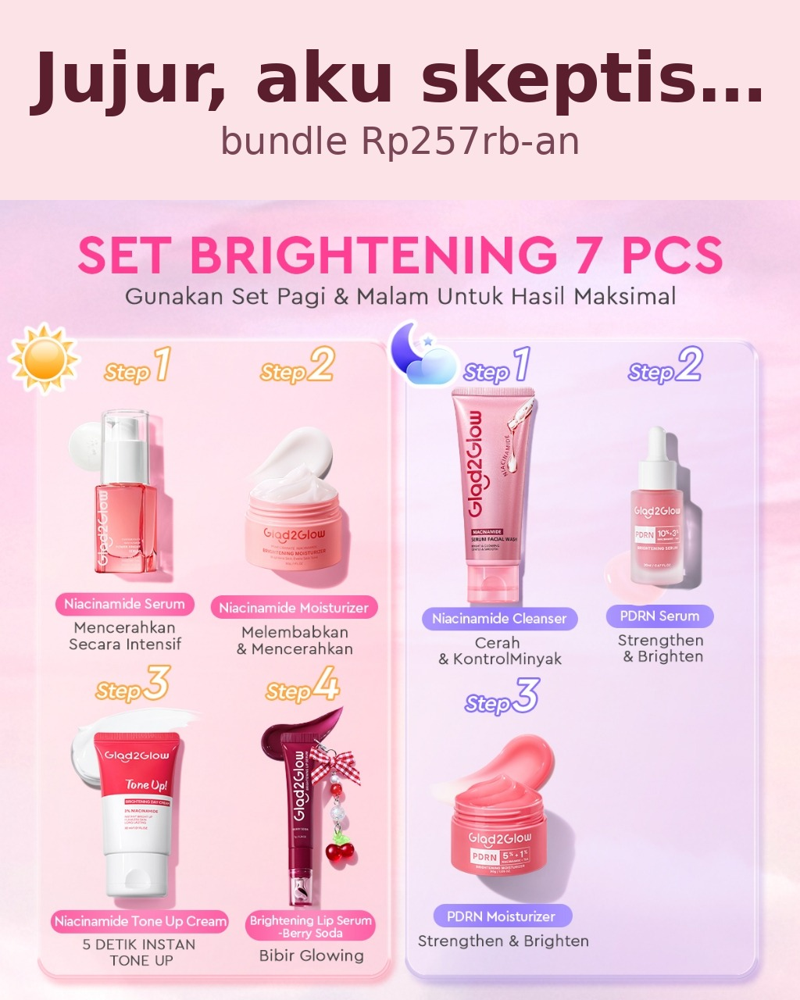
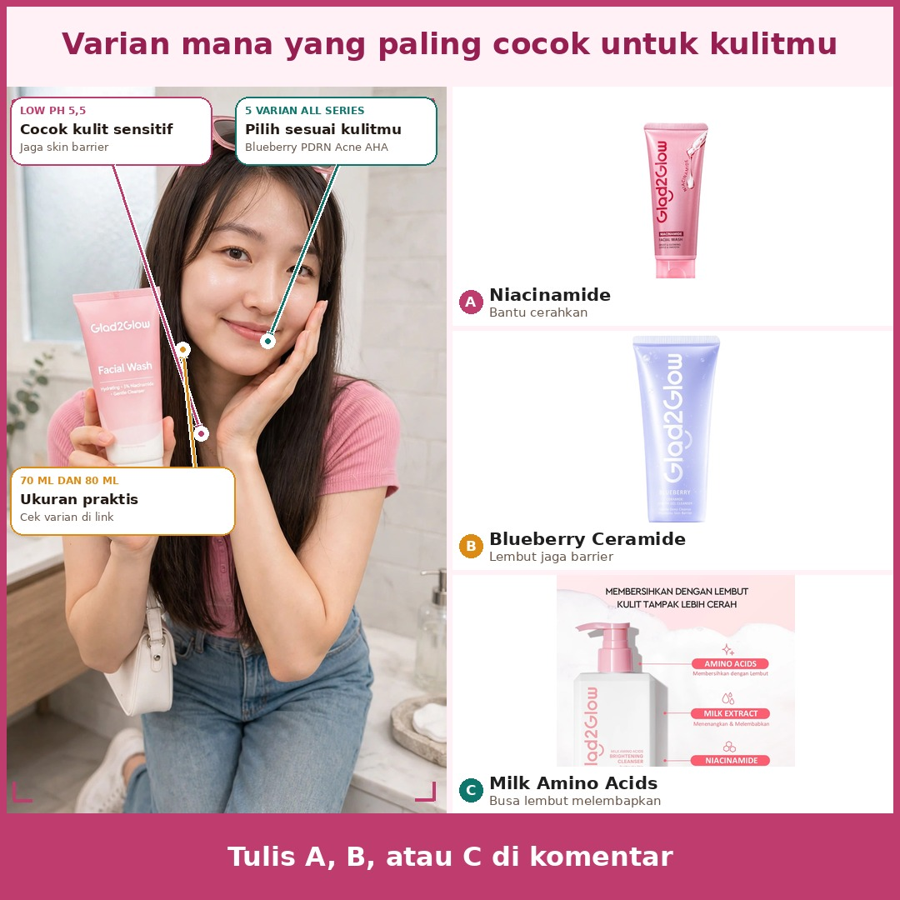
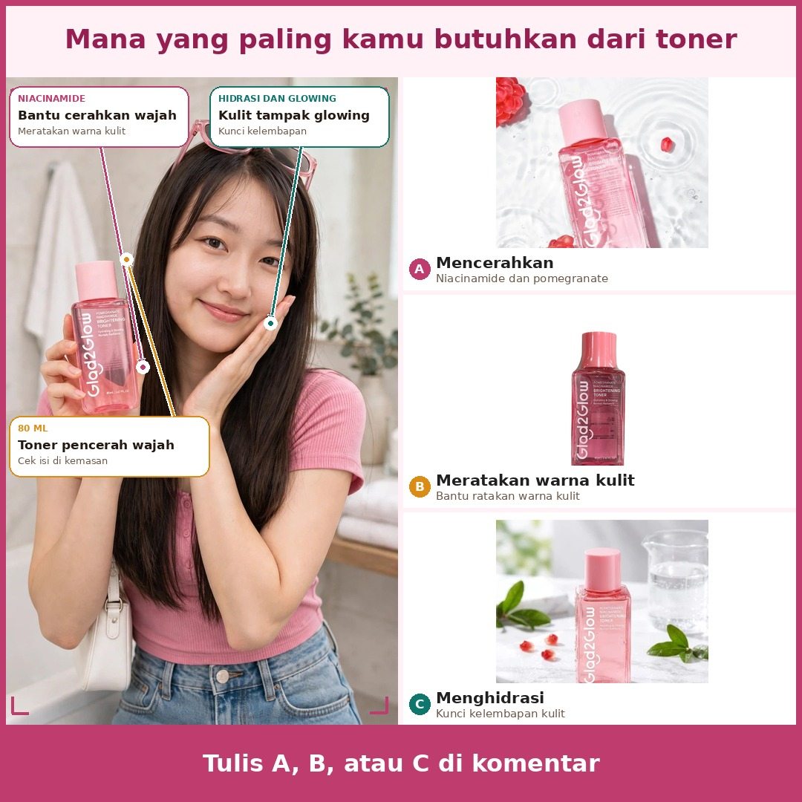
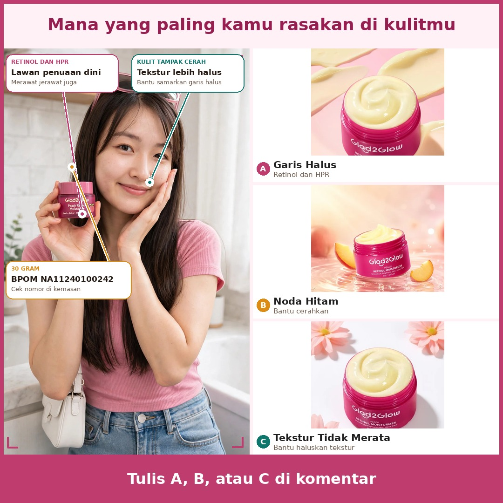

# Meta2ShopeeAff

Kumpulan skill AI untuk menjalankan Meta Ads ke Shopee Affiliate tanpa boncos. Fokusnya angka dulu sebelum spend: hitung komisi bersih, Max CPC, dan break-even, baru buat kreatif dan jalankan iklan dengan aturan kill yang jelas.

## Tentang

Repo ini dibuat untuk affiliate marketer yang mau iklan Meta Ads ke Shopee dengan budget kecil dan terukur. Prinsipnya: produk diuji dulu dengan unit economics, iklan dijalankan dengan budget harian yang dijaga, dan iklan yang boncos dimatikan otomatis sebelum menghabiskan budget.

Yang ada di repo ini:

- Skill untuk memilih produk dan menghitung Max CPC serta break-even.
- Skill untuk membuat storyboard dan kreatif video produk.
- Skill untuk mendengarkan audiens di berbagai platform sebelum menulis copy.
- Skill AutoMeta untuk monitoring berkala, diagnosis EPC vs CPC, auto-kill stop-loss, dan alert pemenang.

Semua skill dipakai bersama dalam satu alur: pilih produk, hitung angka, buat kreatif, jalankan iklan, pantau, dan matikan yang boncos.

## Skills

- `skills/meta-ads-shopee-affiliate-pro/` — Meta Ads untuk Shopee Affiliate: unit economics (Max CPC, break-even), funnel, hooks/copy, ketentuan platform, dan catatan riset Threads.
- `skills/video-editing-skill/` — Editing video dan ide konten produk, termasuk template storyboard sinematik dan one-prompt Flow quick draft. Versi teks saja; aset biner contoh (video/gambar/font .ttf) tidak ikut di repo ini.
- `skills/equinet-audience-listening/` — Audience listening terstruktur lintas Reddit/forum, X/Threads, Instagram/TikTok, LinkedIn, YouTube, dan review sites.
- `skills/autometa/` — AutoMeta: kelola Meta Ads otomatis untuk Shopee Affiliate. Monitoring berkala, diagnosis EPC vs CPC, auto-kill stop-loss (Automated Rules di Ads Manager ditambah loop monitor), alert pemenang, dan scaling.

## Contoh hasil

Contoh hasil yang dibuat dengan skill di repo ini untuk produk Glad2Glow.

| Hasil | Keterangan |
| --- | --- |
|  | Storyboard video 12 detik, CTA di 3 detik terakhir |
|  | Storyboard untuk Flow, satu prompt per scene |
|  | Storyboard 12 detik Glad2Glow Super Renew Set |
|  | Kreatif hook 1 dari foto produk asli |
|  | Kreatif hook 3 dari foto produk asli |
|  | Poster interaktif nomor 1, Facial Wash All Series, dengan model Siena |
|  | Poster interaktif nomor 14, Niacinamide Brightening Toner, dengan model Siena |
|  | Poster interaktif nomor 4, Peach Retinol Moisturizer |

## Cara pakai

Salin folder skill yang dibutuhkan ke direktori skill agen Anda, lalu ikuti instruksi di `SKILL.md` masing-masing skill. Mulai dari `meta-ads-shopee-affiliate-pro` untuk menghitung angka produk, lanjut ke `video-editing-skill` untuk kreatif, dan pasang `autometa` untuk monitoring dan auto-kill setelah iklan jalan.
